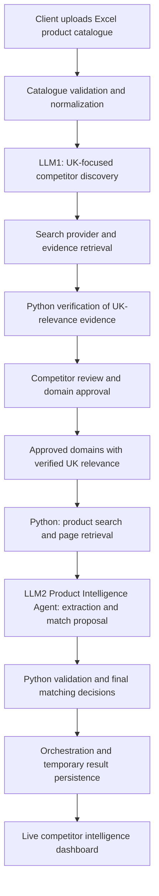

# Stompbox UK Competitor Intelligence
## Architecture and Implementation Plan

**Document status:** Working implementation baseline  
**Purpose:** Keep implementation, code changes, tests, and Claude Code tasks aligned with the agreed product architecture.  
**Market scope:** United Kingdom (UK)  
**Current catalogue input:** Uploaded Excel product catalogue

---

## 1. Purpose and product objective

Build a competitor-intelligence platform for a retailer such as Stompbox. The platform takes a retailer's product catalogue as input, discovers relevant competitors in the UK market, finds competing products, extracts and validates product information, matches competitor products to catalogue products, and presents the results in a live dashboard.

The system is designed around two specialized LLMs:

- **LLM1 — Competitor discovery:** Finds relevant competitor businesses and domains in the UK market.
- **LLM2 — Product Intelligence Agent:** Works on competitor product pages that Python has already searched and retrieved. It extracts and organizes product information and proposes how each page relates to the catalogue product (see §3.6 and §8.6).

LLMs propose and organize information. Deterministic Python code validates evidence, applies business rules, and controls execution.

### Current input decision

For the current implementation, the client supplies an **Excel product catalogue**.

Automatic product-catalogue extraction from a client's website is **not part of the current implementation plan**. It may be considered as a future enhancement, but it must not be introduced into the current scope without explicit approval.

---

## 2. Frozen architecture

The architecture below is the agreed baseline. Implementation details may be improved within these boundaries, but the architecture must not be redesigned without asking the project owner first.

### 2.1 End-to-end workflow

1. The client uploads an Excel catalogue.
2. The system validates and normalizes the catalogue products.
3. LLM1 discovers competitors specifically relevant to the UK market.
4. Search and retrieval services gather evidence about candidate businesses and domains.
5. Python verifies the evidence supporting whether each discovered business is relevant to the UK market.
6. The review workflow presents verified evidence and uncertainty, then supports domain approval or rejection.
7. Approved domains with sufficient verified UK relevance become eligible inputs to product discovery.
8. Python searches approved competitor domains for each selected product and retrieves candidate pages (unchanged search and retrieval behaviour).
9. LLM2 extracts and organizes product information from each retrieved page and proposes a match classification against the catalogue product, citing page quotes.
10. Python validates extracted fields, evidence, prices, availability, and LLM2's match proposal, and makes the final match and price-comparison decisions according to deterministic rules.
11. Results are organized and presented in the live dashboard.

### 2.2 Architecture principles

- UK-focused discovery is performed by LLM1; the system must not become a worldwide discovery system followed by an unnecessarily separate UK discovery subsystem.
- UK relevance must be supported by evidence and deterministic Python verification, not merely by an LLM assertion.
- UK relevance is represented through verified evidence and uncertainty in the discovery/review workflow; there is no separate formal four-category assessment system.
- Human review remains available for uncertain cases and domain approval.
- Domain approval and price-benchmark permission are separate decisions; evidence of UK relevance does not itself approve a domain or grant benchmark permission.
- LLM output is not trusted as verified fact without the applicable Python validation.
- The system should preserve the existing hybrid discovery approach: configured competitors plus newly discovered candidates.
- The current demo uses selected product execution and temporary persistence.
- The dashboard is intended to be live.
- No paid live API calls are made without explicit approval.

---

## 3. Responsibilities by component

### 3.1 Excel catalogue

**Responsibility:** Supply the retailer's own products as the starting point for competitor intelligence.

The catalogue is the current source of product records. It should provide the product identifiers and product information needed for competitor searches and matching.

The current Stompbox demo catalogue contains 100 unique product IDs and Stompbox product URLs. The implementation must continue to support the agreed catalogue workflow.

**Out of scope for now:** Automatically crawling a client website to build the initial catalogue.

### 3.2 LLM1 — Competitor discovery

**Responsibility:** Discover businesses and domains that are relevant competitors in the UK market.

LLM1 should find both:

- UK-based retailers.
- Retailers based outside the UK that serve UK customers.

LLM1 should propose relevant company/domain information and supporting evidence. It should not make final trusted decisions about domain approval or benchmark permission.

The discovery process must cover both UK-based retailers and overseas retailers that serve UK customers. Python verifies the supporting evidence and makes the verified evidence/uncertainty available to the review workflow.

**Approved simplification:** Do not maintain a formal four-category UK assessment system (`UK_BASED`, `SERVES_UK_FROM_ABROAD`, `NOT_SERVING_UK`, `UNKNOWN`) as a separate classification structure. The required outcome is evidence-backed UK relevance, represented directly through verified evidence and uncertainty in the existing discovery and review flow.

### 3.3 Search and retrieval provider

**Responsibility:** Search for candidate businesses/pages and retrieve supporting page content.

Approved decisions:

- Exa is the primary search and retrieval provider.
- Search scope includes whole-web discovery and searches restricted to specific domains.
- The current market scope is UK.
- Existing configured competitor domains and newly approved domains are part of the hybrid discovery approach.

Tavily has been implemented as an alternative provider. Brave was not selected.

Provider choice and API usage must remain configurable through the existing architecture. Do not change provider strategy without approval.

### 3.4 Python validation and business rules

**Responsibility:** Apply deterministic rules to LLM proposals and retrieved evidence.

Examples include:

- Verify that a quoted claim is present in the stored evidence for the cited URL.
- Reject unsupported evidence.
- Verify that evidence supports the claim that a discovered business serves or operates in the UK market.
- Distinguish verified evidence from unsupported claims and uncertainty.
- Do not rely on weak signals such as a `.co.uk` domain or GBP pricing alone.
- Enforce domain approval and the verified UK-relevance requirement before product discovery.
- Validate extracted product fields and prices.
- Keep benchmark permission separate from UK relevance and domain approval.

Python is the enforcement layer for rules that must be predictable and testable.

### 3.5 Human review

**Responsibility:** Resolve uncertain cases and make explicit approval decisions.

Reviewers should be able to inspect verified UK-relevance evidence, unverified claims where exposed, and reasons for uncertainty.

Human domain-approval decisions must remain distinct from evidence verification. A reviewer decision must not rewrite or misrepresent the underlying source evidence.

### 3.6 LLM2 — Product Intelligence Agent

**Responsibility (approved 19 November 2026):** For every selected catalogue product, help answer four questions about each retrieved competitor page:

1. Which competitor sells this product?
2. Is the competitor product an exact match, an equivalent variant, a similar alternative, or not a match?
3. What is its current selling price?
4. Is it available?

LLM2 is **one logical agent** with **three logical tasks**. Each task has its own prompt and its own structured output. The agent uses the existing OpenRouter integration and the configured LLM2 model. No other model or provider is added.

| Task | What LLM2 does | What it returns |
|---|---|---|
| **A: Product identification and matching** | Compares the page's product with the catalogue product using brand, model, SKU, title, specifications, and variants. | A proposed classification: `EXACT_MATCH`, `EQUIVALENT_VARIANT`, `SIMILAR_ALTERNATIVE` or `NOT_A_MATCH`. It also returns the attributes that differ and the reasons, each supported by a verbatim page quote. |
| **B: Product information extraction and organization** | Extracts title, brand, model, SKU, specifications, current selling price, currency, and availability, and normalizes them into one consistent structure. | Field values with verbatim quotes, plus flags for ambiguous variants, conflicting information, and multiple possible prices. |
| **C: Evidence-backed intelligence output** | Combines A and B into one result per page for the dashboard. | A record that answers the four questions and keeps evidence, confidence, and uncertainty explicit. It never fills in missing information. |

**Who answers each question:**

| Question | LLM2 proposes | Python decides |
|---|---|---|
| Which competitor sells it? | Nothing. LLM2 never adds sellers or domains. | Search targets (configured competitors and approved domains), retrieval, and the final match status. |
| How does it match? | Task A classification, reasons, and quotes. | The final match status from deterministic rules: `EXACT_MATCH`, `EQUIVALENT_VARIANT`, `SIMILAR_MATCH`, `REVIEW_REQUIRED` or `NO_MATCH`. LLM2's proposal can never upgrade or replace it (see §8.6). |
| What is the current price? | Task B price, currency, and quote, plus any alternative or excluded prices. | Quote verification, sale-price exclusion, currency, ambiguity, freshness, and benchmark eligibility. Python also decides whether a price is a direct competitor price or an alternative-product price (§8.4.1). |
| Is it available? | Task B availability text, quote, and normalized proposal. | A deterministic availability status from the verified text. Missing, ambiguous, conflicting, or unverifiable evidence gives `UNKNOWN`, never "unavailable". |

**Python keeps these responsibilities (not moved to LLM2):** competitor domain approval and search permissions; search and page retrieval; quote verification; price validation and sale-price exclusion; currency validation; evidence and schema validation; final matching rules and decisions; benchmark eligibility; and pipeline orchestration.

LLM2 proposes; Python validates and determines the final result. LLM2 does not grant domain approval or benchmark permission. Its self-reported confidence is shown as uncalibrated and is never used in a decision.

### 3.7 Orchestration, persistence, and dashboard

**Responsibility:** Coordinate the workflow, store the demo's temporary results and decisions, and expose intelligence through the live dashboard.

The current demo decision is temporary execution persistence. Existing review decisions must continue to persist according to the current review-store design. Do not silently turn temporary intelligence-run results into a permanent data-retention system.

The dashboard should make competitor and product intelligence understandable to a marketing-agency user.

---

## 4. Approved decisions register

The following decisions are treated as approved project constraints.

| Area | Approved decision |
|---|---|
| Product catalogue input | Excel upload for the current scope |
| Website catalogue extraction | Future enhancement, not current scope |
| Geographic market | UK only |
| Competitor discovery | Hybrid: configured competitors plus new discoveries |
| LLM1 | UK-focused competitor discovery |
| UK competitor types | UK-based retailers and overseas retailers serving UK customers |
| Search scope | Whole web and within specific domains |
| Primary search/retrieval provider | Exa |
| Alternative provider | Tavily implemented as an optional alternative |
| Brave | Not selected |
| Product execution | Selected products |
| New domain approval | Hybrid workflow |
| Intelligence-run persistence | Temporary for the demo |
| Dashboard | Live |
| LLM architecture | Two specialized LLMs |
| LLM provider routing | OpenRouter |
| UK relevance | LLM1 performs UK-focused discovery; Python verifies supporting evidence; review shows evidence and uncertainty without a separate four-category assessment system |
| Human review | Required for uncertain candidates and domain approval |
| Benchmark permission | Separate from domain approval and UK relevance; reviewer-controlled |
| Automatic benchmark permission | Automatic domain approval must not grant benchmark permission |
| Configured competitor flags | Existing workbook benchmark flags are preserved |
| Manufacturer/marketplace rules | Existing rules remain unchanged unless explicitly approved |

### 4.1 UK relevance and evidence rules

The approved approach is evidence-based UK relevance verification integrated into LLM1 discovery and the existing review workflow. There is no separate formal four-category assessment structure.

- Discovery must cover UK-based retailers and overseas retailers that serve UK customers.
- Python verifies that supporting quotes/claims are present in the stored evidence.
- The review interface distinguishes verified evidence from unverified claims and makes uncertainty clear.
- Weak signals such as a `.co.uk` domain or GBP pricing alone are insufficient.
- The accepted positive delivery wording includes `sell`, as explicitly decided.
- Existing regression coverage includes wording such as “No delivery charge to the UK” not being treated as evidence that UK delivery is unavailable.

Do not weaken or reinterpret these evidence rules without asking. If a specific case cannot be resolved from the evidence, keep it visibly uncertain for human review rather than inventing a classification.

---

## 5. Domain approval, UK relevance evidence, and benchmark permission

These are distinct concepts and must remain distinct in code, API contracts, UI, and tests. UK relevance is verified through evidence in the discovery/review workflow; it is not a separate approval decision or a standalone four-category subsystem.

### 5.1 UK relevance evidence

Answers: Is there verified evidence that the business operates in or serves the UK market?

Evidence verification does not itself approve a domain or grant benchmark permission. Insufficient or conflicting evidence must remain visible for human review.

### 5.2 Domain approval

Answers: Has this domain been approved to participate in competitor product discovery?

A domain must still go through the agreed approval workflow. UK-relevance evidence does not automatically approve it.

### 5.3 Benchmark permission

Answers: May the competitor's product prices be used as price benchmarks?

Benchmark permission is not implied by UK-relevance evidence or domain approval.

**Current approved behavior:**

- Auto-approval does not grant benchmark permission.
- A reviewer can explicitly set benchmark eligibility where the competitor type permits it.
- Marketplaces remain subject to their existing exclusion rules.
- Configured competitors retain workbook benchmark flags.
- Existing manufacturer rules remain unchanged.

Never use UK relevance or a UK relevance override to set benchmark permission.

---

## 6. Implementation roadmap

The roadmap below organizes work by major deliverable. It is not permission to redesign the architecture or introduce additional subsystems. Keep implementation tasks consolidated into coherent major phases rather than creating many small sub-phases.

### Phase 0 — Foundation and catalogue

**Purpose:** Load and validate the retailer's Excel catalogue and establish the application foundation.

**Expected deliverables:**
- Catalogue ingestion and validation.
- Product normalization and identifiers.
- Backend/frontend foundation and configuration.
- Test coverage for catalogue behavior.

**Status:** Existing foundation is implemented. Verify current repository state before changing it; do not rebuild it.

### Phase 1 — Search and retrieval infrastructure

**Purpose:** Provide reliable whole-web and domain-restricted search and page retrieval.

**Expected deliverables:**
- Provider interface/adapters.
- Exa primary integration.
- Optional Tavily integration.
- Search result normalization.
- Page retrieval and UK URL handling where relevant.
- Provider errors, cost visibility, and tests.

**Status:** Implemented. Exa is configured as the primary provider in the project's existing local configuration. Do not change secrets or `.env` as part of unrelated work.

### Phase 2 — LLM1 competitor discovery

**Purpose:** Discover competitors in the UK market using configured competitors and new discoveries.

**Expected deliverables:**
- UK-focused discovery planning.
- Candidate domain discovery.
- Company/domain classification.
- Profile/evidence collection.
- Evidence-backed UK relevance proposal.
- Deterministic Python validation.
- Review candidate persistence and rerun behavior.

**Status:** Implemented through the completed Phase A work described below.

### Phase 3 — Competitor review and approval

**Purpose:** Let users inspect discovered competitors and make domain decisions.

**Expected deliverables:**
- Review candidates and verified UK-relevance evidence.
- Clear presentation of uncertainty and unsupported claims.
- Human review for uncertain cases.
- Approve/reject workflow.
- Persistent domain decisions.
- Additive review API/event information where needed.
- Benchmark permission kept separate.

**Status:** Implemented through the completed Phase B work and benchmark-permission correction described below.

### Phase 4 — Product search and LLM2 Product Intelligence Agent

**Purpose:** Search approved competitor domains for the selected catalogue products, retrieve candidate pages, and run LLM2's three tasks (extraction, match proposal, and combined output) on them.

**Expected deliverables:**
- Search queries built from catalogue product details. This is deterministic Python and stays unchanged.
- Competitor product page selection and retrieval. This stays unchanged.
- Task B: structured extraction of title, brand, model, SKU, specifications, current price, currency, and availability, with a verbatim quote per field and flags for ambiguous variants, conflicting information, and multiple possible prices.
- Task A: a match proposal (`EXACT_MATCH`, `EQUIVALENT_VARIANT`, `SIMILAR_ALTERNATIVE`, `NOT_A_MATCH`) with reasons and quotes.
- Task C: one evidence-backed result per page for the dashboard.
- Sale-price handling, currency checks, and deterministic availability normalization.
- Clear statuses for not found, unsupported, ambiguous, conflict, and invalid values.
- Tests for each task's structured output and its Python validation.

**Status:** Search, retrieval, and the original single-task extraction are implemented (repository Phase 5, run without an LLM). The three-task agent is planned in §8.6. Reuse the existing implementation; do not start over.

### Phase 5 — Product matching and validation

**Purpose:** Decide deterministically whether a competitor product is the same as, an equivalent variant of, or similar to a catalogue product, or not a match. Use LLM2's proposal only as verified, downgrade-only input.

**Expected deliverables:**
- Product identity and matching logic (implemented: `app/services/matching/`).
- Exact model and variant checks, including handedness, finish, strings, size, wattage, configuration, bundle, generation, edition, and condition (implemented).
- Price validation and the direct UK price-comparison gate (implemented).
- Reconciling LLM2's Task A proposal with the Python decision (planned, §8.6 stage 4; conservative-only, P-4).
- The new final status `EQUIVALENT_VARIANT` (approved, P-2 and U-1): an otherwise identical product whose only difference is cosmetic finish or colour, decided deterministically in Python.
- Separate direct competitor prices and alternative-product prices (§8.4.1).
- Tests covering false matches, variant mismatches, and LLM2 disagreement.

**Status:** The deterministic matcher and price validation are implemented and tested on real no-LLM data. The LLM2 proposal integration, the `EQUIVALENT_VARIANT` status, and the alternative-price result are planned but not implemented.

### Phase 6 — Orchestration, temporary persistence, and live dashboard

**Purpose:** Connect the end-to-end workflow and present useful results in the dashboard.

**Expected deliverables:**
- Selected-product run orchestration.
- Approved-domain enforcement.
- Temporary intelligence-run persistence as agreed.
- Review-decision persistence retained.
- Dashboard display of competitor products, matches, prices, availability, evidence, and run status.
- Useful error and exclusion explanations.
- API/frontend integration.

**Status:** Existing dashboard and orchestration work exists. Inspect the actual current implementation and identify gaps; do not rebuild without evidence.

### Phase 7 — Integration testing and demo readiness

**Purpose:** Verify the complete agency-facing workflow and prepare the live demo.

**Expected deliverables:**
- End-to-end tests from Excel catalogue to dashboard.
- API and CLI consistency where both are supported.
- Search-provider and retrieval tests.
- LLM structured-output and failure tests.
- Evidence/price/matching validation tests.
- Frontend tests, lint, and build.
- Controlled live test after explicit cost approval.
- Demo setup instructions and known limitations.

**Status:** Pending full end-to-end validation.

---

## 7. Current implementation checkpoint

This section records the latest reported state as of **19 November 2026**. It is a checkpoint, not a substitute for inspecting the repository before a new code change.

### 7.1 Competitor discovery and UK evidence verification — implemented; simplification pending

Reported implementation includes:

- LLM1 planning prompt updated for UK-market competitor discovery.
- Discovery covers UK-based retailers and overseas retailers serving UK customers.
- Profile evidence searches target about/contact pages, addresses, showrooms, company registration, and delivery/shipping terms.
- Evidence selection reserves up to three of eight slots for profile evidence.
- LLM1 returns proposed UK relevance information and evidence quotes.
- Python verifies quotes against stored evidence.
- The current code also contains the formal four-category assessment, confidence, persistence, and API exposure. These are existing implementation details, not the approved target architecture.
- The next implementation task is to inspect dependencies and simplify/remove the formal category structure while preserving evidence verification and uncertainty handling.

**Latest reported backend suite after Phase A:** 945 passed.

### 7.2 Review and approval — completed

Reported implementation includes:

- Deterministic `uk_review()` recommendations.
- Review cards display UK-relevance evidence, unverified claims, and reasons for uncertainty.
- The current implementation uses the formal category assessment to drive some review behavior; inspect and simplify these dependencies as part of the Option B cleanup.
- Domain approval remains a separate decision.
- Review API and discovery events expose review information additively.
- Existing evidence wording behavior, including accepted `sell` wording, must be preserved.
- Benchmark permission remains independent and must not be derived from UK-relevance evidence.

**Latest reported tests after Phase B:** 1,001 backend tests passed; 105 frontend tests passed; lint and build succeeded.

### 7.3 Benchmark permission correction — completed

A subsequent correction changed `decide()` so automatic domain approval no longer grants `price_benchmark = True`.

Reported behavior:
- Auto-approved UK-based retailers do not receive benchmark permission automatically.
- Auto-approved overseas retailers serving the UK do not receive benchmark permission automatically.
- Reviewers can explicitly grant permission where type rules allow.
- Marketplaces remain ineligible under existing rules.
- Configured competitors retain workbook flags.
- Manufacturer rules remain unchanged.

**Latest reported backend suite:** 1,007 passed, 0 failed, 0 skipped.

### 7.4 Legacy UK gate and assessment dependencies — unresolved

The repository was reported to contain an older UK gate dependency based on v2 UK records/exceptions. The real database was reported as version 1, and product searches remained blocked by the old gate.

Under the approved Option B simplification:
- Do not add a new UK eligibility subsystem or standalone gate.
- Inspect the legacy gate and the formal four-category assessment dependencies together.
- Identify the minimum changes needed so LLM1 UK-focused discovery, Python evidence verification, and domain approval determine which domains can reach product discovery.
- Retire redundant legacy gate/category behavior safely, while preserving approval safeguards and evidence visibility.
- Do not make schema migrations or code changes until the dependency review and implementation plan have been reviewed.

This must be done without changing the two-LLM architecture or weakening approval/evidence safeguards.

### 7.5 LLM2/product intelligence — partially implemented

Existing Phase 5 implementation notes:
- Search and retrieval against Exa work.
- Selected-product runs can search configured/approved competitor domains.
- LLM2 extraction is not operational until its model and OpenRouter key are configured.
- Without LLM2 configured, pages can be searched/retrieved but extracted fields remain empty.
- Existing tests cover retrieval, extraction validation, sale-price exclusion, malformed output, missing configuration, and related behavior.

The existing LLM2 implementation must be inspected and completed/reused, not recreated.

**Product Intelligence Agent evolution (stages 1–5 implemented 19 November 2026, uncommitted):** Tasks A, B, and C, availability normalization, `EQUIVALENT_VARIANT`, conservative-only reconciliation, and direct versus alternative prices are implemented as planned in §8.6. They were built and tested with fake LLM and provider responses. Stage 6 (controlled live evaluation) was then authorized and run twice on 19 November 2026 (Stage 6 and Stage 6.2: SB-001 and SB-028 on Andertons and Gear4music, about $0.04 each); the follow-up fixes (Stages 6.1, 6.1.1 and 6.3) were made and tested offline. See §8.6.5. One planned detail was not added: the optional separate `LLM2_MATCH_MAX_COMPLETION_TOKENS`. Both calls share `LLM2_MAX_COMPLETION_TOKENS`, because the existing client takes one output cap. Code notes are in CLAUDE.md under "Product Intelligence Agent, stages 1-5".

### 7.6 Repository checkpoint

Last known checkpoint:
- Branch: `wip/uk-gate-2026-11-17`
- Commit: `a6d5a15` on top of `970c7be`
- The checkpoint contained 33 reviewed staged files at that time.
- Later Phase A, Phase B, and benchmark correction work was reported as uncommitted.
- No later changes were staged or committed according to the reports.

**Important:** These repository facts may have changed. Claude Code must inspect `git status`, current branch, and recent commits before making changes. Never assume the checkpoint is still current.

---

## 8. Product discovery and extraction requirements

This section records requirements already established for the product intelligence workflow.

### 8.1 Domain scope

Product searches should use configured competitors and domains that have been approved through the review workflow. Pending and rejected domains must not be searched. Directory/marketplace sites must follow their existing eligibility rules.

The UK market is the scope. For overseas retailers, verified evidence must establish that they serve UK customers. Do not introduce a separate formal category assessment or independent UK eligibility subsystem.

### 8.2 Product search

Search queries should use available product identifiers and distinguishing information, such as:
- Brand.
- Model.
- Product name.
- Variant details (for example left-handed or finish).
- Specifications when available and useful.

The existing implementation used one Exa search per domain, selected up to two pages per domain and up to twenty pages per product, then batched retrieval per product. Verify current code before changing these limits.

### 8.3 Extraction fields

Existing extraction design includes:
- Title.
- Brand.
- Model.
- SKU.
- Price.
- Currency.
- Price as shown.
- Availability.
- Specifications.

Each extracted field should have a status and supporting quote/evidence.

Planned additions (Task B, §8.6): alternative current prices for other options or variants, a normalized availability proposal, normalized specification names (with verbatim values), and issue flags for ambiguous variants, conflicting information, and multiple possible prices.

### 8.4 Price handling

Existing rules:
- Extract the price the customer pays now.
- If a page says “Was £219 Now £189”, retain £189.
- Do not treat crossed-out/original/RRP/was/save amounts as the current price.
- Do not calculate savings or discounts unless separately approved.
- Validate currency and quote context.
- Do not trust a price solely because the LLM returned it.
- **Multiple current prices (approved, P-6):** if the page shows more than one current price and Python cannot reliably associate one of them with the catalogue product or its variant, the price is `AMBIGUOUS` and is not compared. The system never automatically selects the lowest price, the first price, or a default option's price.

### 8.4.1 Direct competitor prices and alternative-product prices

These are two separate kinds of price. They are calculated, stored, and displayed separately, and they are never mixed.

| | Direct competitor prices | Alternative-product prices |
|---|---|---|
| **Final match status** | `EXACT_MATCH` only | `EQUIVALENT_VARIANT` or `SIMILAR_MATCH` |
| **Meaning** | The competitor sells the same product, including its required variant. | The competitor sells a related product: an equivalent variant or a similar alternative. |
| **Use** | Direct price benchmarking against the Stompbox price. | Shown as information about alternative products. |
| **Price difference** | Shown, as competitor − Stompbox in GBP. No percentages, savings, or discounts. | Not used in direct comparisons, averages, or counts of comparable prices. |
| **Requirements** | Everything the existing comparison gate checks: a `VALID` GBP price with `VERIFIED` evidence, a competitor marked as a price benchmark, and comparable condition. | The same price validation (quote, sale exclusion, currency, ambiguity, freshness). No benchmark flag is needed, but the domain must already be approved for product search (configured or reviewer-approved, or auto-approved in this run where that is enabled). Used and refurbished items may be shown, always with an explicit condition label (approved, U-2). |
| **Dashboard** | The main comparison table and price KPIs. | A separate, clearly labelled "Alternative products" section. |

`EQUIVALENT_VARIANT` is not eligible for exact-product price benchmarking by default. Changing that needs a new explicit approval. `REVIEW_REQUIRED` and `NO_MATCH` prices appear in neither group. Their price evidence stays visible in the evidence view only.

### 8.5 Product matching

The matching layer must distinguish exact products from merely similar products. Variant differences can make products non-equivalent. A match must be explainable and supported by evidence.

Do not invent a matching threshold or silently change match semantics. If the current implementation does not specify a necessary threshold or business rule, ask the project owner.

LLM2's Task A classification is a **proposal**. The final status stays a Python decision.

**Final statuses (approved, P-2 and P-3).** The existing statuses in `app/schemas/common.py` are kept, and one is added:

| Final status | Meaning |
|---|---|
| `EXACT_MATCH` | Same product identity and required variant. |
| `EQUIVALENT_VARIANT` (new) | A different variant of the product that Python judges equivalent from its product characteristics. Not benchmark-eligible by default. |
| `SIMILAR_MATCH` | A related alternative, not the same product. |
| `REVIEW_REQUIRED` | A possible match with unresolved identity or variant evidence. |
| `NO_MATCH` | The evidence does not support a match. |

**Variant equivalence depends on product characteristics.** Two products are not equivalent variants just because they belong to the same product family, series, or model line.

**Equivalent-variant rule (approved, U-1).** Python applies this rule deterministically. It grants `EQUIVALENT_VARIANT` only when both of these hold:

1. **The product is otherwise the same.** Every check that `EXACT_MATCH` requires passes:
   - the page is a single-product page;
   - the brand matches;
   - the exact model identifier is found in at least two independent evidence groups;
   - no critical variant conflict apart from finish;
   - comparable condition;
   - nothing that would otherwise make the result `REVIEW_REQUIRED`.
2. **The only difference is cosmetic finish or colour.** The finish check is `CONFLICT`, and no other characteristic differs.

These differences never qualify: handedness, size, configuration, electronics (for example, pickups or a different electronics package), functional specifications (for example, string count, wattage, generation, or edition), and model. They give `SIMILAR_MATCH` when the evidence shows the difference, and `REVIEW_REQUIRED` when the evidence is unclear or unverified.

This changes one current outcome. Today a finish-only conflict on an otherwise exact product gives `SIMILAR_MATCH`. Under the approved rule it gives `EQUIVALENT_VARIANT`. Every other existing outcome is unchanged.

The matcher does not detect electronics or functional-specification differences beyond its current variant checks. They are handled conservatively: a verified differing characteristic from LLM2's Task A proposal makes the result `REVIEW_REQUIRED` (U-4), never `EQUIVALENT_VARIANT`.

**Mapping of LLM2 proposal labels to final statuses (approved, P-3):**

| LLM2 proposal | Corresponding final status |
|---|---|
| `EXACT_MATCH` | `EXACT_MATCH` |
| `EQUIVALENT_VARIANT` | `EQUIVALENT_VARIANT` |
| `SIMILAR_ALTERNATIVE` | `SIMILAR_MATCH` |
| `NOT_A_MATCH` | `NO_MATCH` |

The mapping is used only to compare the proposal with Python's decision. The proposal never becomes the final status.

### 8.6 Product Intelligence Agent: reuse, changes, stages, and open decisions

This subsection is the plan for evolving LLM2 into the three-task Product Intelligence Agent. It is a plan only. No code, tests, environment, or database records have been changed for it.

#### 8.6.1 Constraints

- LLM2 stays one logical agent, with separate task prompts and structured outputs.
- It reuses the existing OpenRouter client (`OpenRouterClient.complete_structured`: strict `json_schema`, one repair retry, truncation handling, usage and cost recording) and the configured `LLM2_MODEL`. No new model or provider.
- Search, query building, page selection, caps, and retrieval stay unchanged.
- Domain approval, search permissions, and benchmark rules stay unchanged. Benchmark eligibility still rides on `SearchTarget.price_benchmark`.
- Evidence-backed extraction stays: a value is kept only if its quote is verbatim in the page and the value is in its quote. Current-price validation stays (`app/services/prices.py`, `rules._check_price`, `matching/price.validate_price`).
- `LLM_DISABLED` mode keeps working: Tasks A and B are skipped, and Python matching runs on titles and URLs as today.
- LLM2 never invents values. Unknown stays null with an explicit status.

#### 8.6.2 Existing components to reuse

| Component | File | Reuse |
|---|---|---|
| LLM gateway | `app/services/llm/` (`LLMClient`, `OpenRouterClient`, `LLMOutputError`, `build_llm2`) | Unchanged. Every task calls `complete_structured` with its own schema. |
| Agent loop | `app/agents/intelligence/agent.py` | Keep search, selection, retrieval, concurrency, account-error stop, and usage accounting. Extend `_extract` to run the task sequence. |
| Task B contract and checks | `schemas.PageExtraction`, `rules.check_extraction`, `rules._check_text_field`, `rules._check_price` | Extend with additive fields. Keep every existing check. |
| Price rules | `app/services/prices.py`, `matching/price.validate_price` | Unchanged. Add a multiple-current-price check. |
| Deterministic matcher | `matching/matcher.py` (`Evidence`, `check_*`, `decide`, `compare`), `matching/attributes.py` | Unchanged rules. Add one reconciliation step after `decide`. |
| Downgrade-only pattern | `discovery/rules.classify_competitor` | Template for reconciling an LLM proposal with a Python decision (stored proposal, final value, recorded reasons). |
| Records and statuses | `CompetitorProduct`, `FieldEvidence`, `FieldStatus`, `CandidateMatch`, `MatchStatus`, `EvidenceStatus` | Extend additively. Existing fields keep their meaning. |
| Pipeline and SSE | `app/orchestration/pipeline.py` (`competitor_product_extracted`, `match_validated`, `price_validated`) | Same stages. Event payloads get additive fields. |
| Dashboard | `ComparisonTable.tsx`, `EvidencePanel.tsx`, `status.ts`, `api.ts` | Show the proposal next to the final status, plus availability status and issues. |
| Test fakes and fixtures | `tests/intelligence_fakes.py`, `matching_fakes.py`, `pipeline_fakes.py`, `tests/fixtures/phase5_no_llm_run.json`, `make_dashboard_fixture.py` | Extend the fake LLM to answer per task schema. Regenerate the dashboard fixture. |

#### 8.6.3 Required code changes

1. **Task B schema (`schemas.py`, `prompts.py`, `rules.py`).** Add these fields to `PageExtraction`:
   - `alternative_prices`: current prices for other options or variants, each with text, quote, and the option it belongs to. These are not sale prices.
   - `availability_normalized`: a proposal from a fixed enum.
   - `specifications[].normalized_name`.
   - `issues`: a list of `{kind: AMBIGUOUS_VARIANT | CONFLICTING_INFORMATION | MULTIPLE_PRICES | MISSING_INFORMATION, fields, description, quotes}`.

   Python verifies every quote. If a verified alternative amount is also a current price for the same product, the price becomes `AMBIGUOUS` ("multiple possible prices"). Issues whose quotes fail verification are kept as unverified and do not affect decisions. `CompetitorProduct` gets matching additive fields (`alternative_prices`, `availability_status`, `extraction_issues`).
2. **Availability normalization (new small module, e.g. `app/services/availability.py`).** A deterministic mapping from the verified availability text to one of six statuses (approved, P-5):

   | Status | Used when |
   |---|---|
   | `IN_STOCK` | The verified text states that the product is in stock or available to buy now. Explicit low-stock wording such as "Only 2 left" or "Low stock" also counts, when the page shows the product can be bought now (approved, U-3). |
   | `OUT_OF_STOCK` | The verified text states that it is out of stock or currently unavailable. |
   | `PREORDER` | The verified text offers it for pre-order before release. |
   | `BACKORDER` | The verified text says it can be ordered now for later fulfilment (back-order, "on order", "awaiting stock"). |
   | `DISCONTINUED` | The verified text states that it is discontinued or no longer available. |
   | `UNKNOWN` | The evidence is missing, ambiguous, conflicting, or unverifiable. This includes a quote not found in the page, several contradictory stock texts, and LLM2's proposal disagreeing with the deterministic mapping. |

   Search not finding a page never makes a product unavailable (CLAUDE.md §10).
3. **Task A: match proposal (`schemas.py`, `prompts.py`, `rules.py`, `agent.py`).**
   - New `MatchProposal` output: classification (the four values), `differing_attributes` (attribute, catalogue value, page value, quote), reasons with quotes, and uncalibrated confidence.
   - It gets its own system prompt, which receives the catalogue product (brand, model, name, specifications, variant details), the page text, and Task B's verified fields.
   - Python verifies quotes. A proposal with an unverified supporting quote is stored as `UNSUPPORTED` and ignored by the matcher.
   - Call structure (approved, P-1): two LLM2 calls per eligible page. Task B runs first. Task A runs second, and only on a retrieved page that Task B classified as `product_page`. Task C makes no LLM call.
   - New per-candidate fields: `match_proposal`, `match_proposal_status` (`COMPLETED`, `SKIPPED_NO_LLM`, `SKIPPED_NOT_ELIGIBLE`, `UNSUPPORTED`, `FAILED`), and per-task request IDs. Usage is counted per task.
   - Tasks A and B stay separate, so B's extraction prompt keeps its current rule not to judge identity.
4. **Matcher: equivalent variants and reconciliation (`app/schemas/common.py`, `matching/matcher.py`, `matching/schemas.py`).**
   - Add `EQUIVALENT_VARIANT` to `MatchStatus`. In `decide`, Python grants it on its own, without LLM2, when the cosmetic-variant rule in §8.5 holds. In code terms: model `MATCH` in two or more evidence groups, finish is the only critical `CONFLICT`, and nothing else in the evidence calls for review.
   - After `decide`, apply the reconciliation rule (approved, P-4 and U-4). LLM2 cannot upgrade, downgrade, or replace Python's classification. `REVIEW_REQUIRED` is the only direct effect a disagreement can have.
   - That effect applies when Python's status is `EXACT_MATCH` or `EQUIVALENT_VARIANT`, and the verified proposal either maps to a less certain status or names a verified differing non-cosmetic characteristic. The final status then becomes `REVIEW_REQUIRED`, and the proposal's reason and quotes are recorded in `review_reasons`.
   - In every other case the disagreement is only recorded, in `proposal_agreement` and as an uncertainty. That covers Python being stricter (for example, Python says `EQUIVALENT_VARIANT` and LLM2 proposes `EXACT_MATCH`) and any disagreement on `SIMILAR_MATCH`, `REVIEW_REQUIRED` or `NO_MATCH`.
   - `CandidateMatch` gains `proposed_match`, `proposal_status`, and `proposal_agreement` (`AGREES`, `PYTHON_STRICTER`, `LLM_STRICTER`, `NOT_AVAILABLE`).
   - `compare` keeps direct comparison to `EXACT_MATCH` only.
   - A separate `alternative_price` result covers `EQUIVALENT_VARIANT` and `SIMILAR_MATCH`:
     - it carries the validated price, the condition label, and `benchmark_eligible=false`;
     - it has no difference field and does no difference calculation;
     - it needs no benchmark flag, but the competitor must be a search-approved target;
     - it is never counted in `comparable_prices` (§8.4.1).
   - Add `EQUIVALENT_VARIANT` to the run counts, the pipeline summary, and the frontend status mirror (`status.ts`, `api.ts`).
5. **Task C: combined output (`schemas.py`, API, pipeline).**
   - A `ProductIntelligenceView` per candidate answers the four questions: seller (competitor and benchmark flag), match (final status, proposal, agreement, reasons), price (validation status, amount, quote, source URL, retrieval time, and price kind: `DIRECT`, `ALTERNATIVE` or none), and availability (status, text, quote).
   - It carries an `uncertainties` list collected from field statuses, issues, and review reasons.
   - It is assembled by Python from verified data (decision P-1). API responses and SSE payloads only gain fields.
6. **Settings (`core/config.py`, `.env.example` only).**
   - `INTELLIGENCE_MATCH_PROPOSALS` (on by default when LLM2 is configured).
   - An optional `LLM2_MATCH_MAX_COMPLETION_TOKENS` that defaults to `LLM2_MAX_COMPLETION_TOKENS`.
   - The real `backend/.env` is not edited without approval.
   - Live provider calls stay disabled (P-7). Every stage before stage 6 runs on fakes and fixtures only.
7. **Frontend.**
   - Show the proposal next to the final status, and say when Python was stricter.
   - Add an `EQUIVALENT_VARIANT` status style.
   - Show availability status and issues in the evidence drawer.
   - Show direct competitor prices and alternative-product prices in separate sections, so alternative prices never appear in the exact-match table or price KPIs.
   - Keep the price display rules: no arithmetic in the UI and no discounts.
8. **Docs.** Update `docs/product-intelligence.md`, `docs/product-matching.md`, `docs/dashboard.md`, and CLAUDE.md after each stage is approved.

#### 8.6.4 Required tests

- **Task B rules** (`test_intelligence_rules.py`):
  - alternative prices give `AMBIGUOUS`; a sale-labelled alternative stays excluded;
  - issues with unverified quotes have no effect;
  - normalized spec names keep the verbatim value check;
  - all existing extraction tests still pass unchanged.
- **Availability** (new test file):
  - a mapping table covering UK retail wordings for all six statuses;
  - "Only 2 left" and "Low stock" on a page where the product can be bought now give `IN_STOCK`;
  - low-stock wording without that signal gives `UNKNOWN`;
  - missing, ambiguous, conflicting, unverified, and disagreeing evidence each give `UNKNOWN`;
  - "unavailable" is never inferred.
- **Task A schema and rules:**
  - strict-schema round trip;
  - unverified quotes give `UNSUPPORTED`;
  - quotes that are only in the reference product (not the page) are rejected;
  - the proposal is skipped when Task B failed or the page was not retrieved.
- **Agent** (`test_intelligence_agent.py`, with the fake LLM):
  - task order and per-task schemas;
  - usage counted per task;
  - an account error stops both tasks;
  - `LLM_DISABLED` behaves as before;
  - truncation is never parsed.
- **Matcher** (`test_matching_rules.py`):
  - LLM disagreement turns an exact match or equivalent variant into review;
  - LLM2 never upgrades or replaces a status (for example, a `REVIEW_REQUIRED` or `SIMILAR_MATCH` with a proposed `EXACT_MATCH` stays the same, and a proposed `NOT_A_MATCH` never produces a final `NO_MATCH`);
  - an unsupported proposal is ignored;
  - a finish-only conflict on an otherwise exact product gives `EQUIVALENT_VARIANT`;
  - differences in handedness, size, configuration, strings, wattage, generation, edition, or model never give `EQUIVALENT_VARIANT` (`SIMILAR_MATCH` with the evidence, `REVIEW_REQUIRED` when unverified);
  - a finish conflict combined with any other conflict or open review reason is not `EQUIVALENT_VARIANT`;
  - a verified LLM2 differing electronics or functional characteristic turns `EQUIVALENT_VARIANT` or `EXACT_MATCH` into `REVIEW_REQUIRED`;
  - Python's `EQUIVALENT_VARIANT` with an LLM2 `EXACT_MATCH` proposal stays `EQUIVALENT_VARIANT`;
  - used and refurbished alternative prices carry their condition label;
  - alternative prices never have a difference, and need a search-approved domain but no benchmark flag;
  - the existing real-run fixture gives the same results with no proposal.
- **Prices:**
  - multiple current prices that cannot be associated with the product or its variant give `AMBIGUOUS`, and the lowest is never chosen;
  - `EQUIVALENT_VARIANT` and `SIMILAR_MATCH` prices appear only as alternative-product prices, with no difference and no count in `comparable_prices`;
  - benchmark eligibility is unchanged.
- **API and pipeline** (`test_intelligence_api.py`, `test_pipeline.py`): additive contract fields, and SSE payload fields present and free of secrets.
- **Frontend** (Vitest): proposal and final status rendering, the availability pill, the uncertainty list, and fixture regeneration. Also run lint and build.

#### 8.6.5 Implementation sequence (independently testable stages)

Each stage is reviewed before the next starts. No stage makes a paid call. All tests use fakes and fixtures.

| Stage | Scope | Testable outcome |
|---|---|---|
| 1. Task B extension | `PageExtraction` and `CompetitorProduct` additive fields, the prompt update, and the rules for alternative prices and issues | Rule and agent tests pass. Existing extraction and matching tests pass unchanged. |
| 2. Availability normalization | Deterministic module plus wiring into `CompetitorProduct` | Mapping tests pass. No other behaviour changes. |
| 3. Task A match proposal | `MatchProposal` schema, prompt, quote verification, agent call sequence, settings flag, and usage | Agent tests with the fake LLM pass. The matcher ignores the proposal at this stage, so match results are unchanged. |
| 4. Python matching and reconciliation | `EQUIVALENT_VARIANT` status and rule, conservative-only reconciliation, the alternative-price result, and the new `CandidateMatch` fields | Matcher tests pass, including "never upgrades or replaces". The real no-LLM fixture is unchanged. |
| 5. Task C output, API and dashboard | `ProductIntelligenceView`, additive API and SSE fields, separate direct and alternative price sections, and frontend display | API, pipeline, and Vitest tests pass. Lint and build succeed. |
| 6. Controlled live evaluation | A small, fixed set of pages and products with the real model | **Run 19 November 2026 (twice, after budget approval).** 2 products × 2 retailers, 4 pages and 8 LLM2 calls per run, no failures. Findings were fixed offline in Stages 6.1, 6.1.1 and 6.3 (sale flag and delivery prices, spec categories, finish aliases, geographic availability, SB-028 approved Figured identity). Extraction accuracy, latency and cost per full pipeline run are not yet measured at scale (Phase 9). |

#### 8.6.6 Decisions (updated 19 November 2026)

| ID | Decision | Status |
|---|---|---|
| P-1 | Two LLM2 calls per eligible single-product page: extraction (Task B) first, match proposal (Task A) second. Task C is assembled in Python with no LLM call. | Approved |
| P-2 | `EQUIVALENT_VARIANT` is a distinct final classification. It is not eligible for exact-product price benchmarking by default, but its price may be shown as alternative-product information. Equivalence depends on product characteristics, not on belonging to the same product family. | Approved |
| P-3 | Final statuses: `EXACT_MATCH`, `EQUIVALENT_VARIANT`, `SIMILAR_MATCH`, `REVIEW_REQUIRED`, `NO_MATCH`. LLM2's `SIMILAR_ALTERNATIVE` maps to `SIMILAR_MATCH`, and `NOT_A_MATCH` maps to `NO_MATCH`. | Approved |
| P-4 | LLM2 never upgrades or replaces a Python decision. It may only add uncertainty or lead to a more conservative outcome. | Approved |
| P-5 | Availability statuses: `IN_STOCK`, `OUT_OF_STOCK`, `PREORDER`, `BACKORDER`, `DISCONTINUED`, `UNKNOWN`. `UNKNOWN` covers missing, ambiguous, conflicting, or unverifiable evidence. Refinement approved 20 November 2026 (Stage 6.3.1): a geographic or delivery restriction is always `UNKNOWN`; explicit product stock wording ("Out of stock", "Sold out") stays `OUT_OF_STOCK` when LLM2 proposes only `UNKNOWN`; any other disagreement is still `UNKNOWN`. | Approved |
| P-6 | A price is `AMBIGUOUS` when multiple current prices cannot be reliably associated with the catalogue product or its variant. The lowest price is never selected automatically. | Approved |
| P-7 | Live tests need an explicitly approved budget. A budget was approved for the two small Stage 6 runs (19 November 2026); any further live run needs a new approval. | Approved; Stage 6 budget used |
| U-1 | `EQUIVALENT_VARIANT` only when the product is otherwise the same and the only difference is cosmetic finish or colour. Differences in handedness, size, configuration, electronics, functional specifications, or model do not qualify (`SIMILAR_MATCH` or `REVIEW_REQUIRED`, depending on evidence). Python applies the rule deterministically. | Approved, closed |
| U-2 | Alternative prices need no benchmark flag, but the domain must already be approved for product search. Used or refurbished items may be shown with an explicit condition label. No price difference is calculated for alternative products. Alternative prices stay separate from exact-match benchmark prices. | Approved, closed |
| U-3 | Explicit wording such as "Only 2 left" or "Low stock" is `IN_STOCK` when the page shows the product can be bought now. | Approved, closed |
| U-4 | `REVIEW_REQUIRED` is the only direct effect of a disagreement between LLM2 and Python. LLM2 cannot directly downgrade or replace Python's classification. Python may assign `EQUIVALENT_VARIANT` on its own when its deterministic cosmetic-variant rule holds. | Approved, closed |

**Decided (20 November 2026):** SB-028 is the Epiphone Les Paul Standard '60s Figured Left-Handed (a model designation, not a finish; see `docs/product-matching.md`, "Approved identity decisions").

**Still unresolved (20 November 2026):** the SB-028 price baseline (the catalogue's £579 was recorded as a sale price, "was £599"; the catalogue price is used unchanged and is not independently verified), and a budget for any further live run. Stages 1 to 6 are complete.

---

## 9. Engineering and testing standards

### 9.0 Approved Option B simplification

The project owner selected the simplified UK relevance approach (Option B) on 19 November 2026.

The target is UK-focused LLM1 discovery plus deterministic Python verification of supporting evidence, with verified evidence and uncertainty shown in the existing review workflow. Do not retain a standalone formal four-category assessment system as a product/architecture requirement, and do not create a separate UK eligibility subsystem.

Before implementation, inspect all code, API, UI, persistence, test, and legacy-gate dependencies on the existing categories and assessment fields. Propose the smallest safe cleanup first. Preserve domain approval, benchmark permission independence, configured competitor flags, and existing manufacturer/marketplace rules. Do not edit code, migrate databases, stage, or commit until the proposed changes have been reviewed and authorized.

Every implementation task must follow these rules.

### 9.1 Before coding

- Inspect the current code and working tree.
- Identify the exact existing components involved.
- Compare the requested change with this plan.
- Identify any conflict with an approved decision.
- Ask before implementing a change that would alter the architecture or an approved decision.

### 9.2 During implementation

- Implement one coherent major deliverable at a time.
- Do not create unnecessary micro-phases or repeated versions of a phase.
- Reuse existing interfaces and tests.
- Keep API changes backward-compatible where practical.
- Do not add a database migration unless it is genuinely required; explain why.
- Do not modify `.env`, secrets, or real database data unless explicitly authorized.
- Do not make paid API calls or live provider runs without explicit approval.
- Do not stage or commit unless explicitly requested.

### 9.3 After implementation

Report:
1. What changed.
2. Which files changed.
3. How behavior maps to this plan.
4. Tests run and exact results.
5. Any deviations or unresolved issues.
6. Whether paid calls, real DB changes, migrations, `.env` changes, staging, or commits occurred.

Tests should cover both new behavior and preservation of existing approved behavior.

### 9.4 Required test layers

- Unit tests for deterministic Python rules.
- Schema and structured-output tests for LLM interfaces.
- Integration tests for discovery, review, retrieval, extraction, and orchestration.
- API tests for response contracts.
- Persistence/rerun tests.
- Frontend tests, lint, and build when frontend code changes.
- Controlled end-to-end/live testing only after explicit approval of cost and environment.

---

## 10. Architectural boundaries — changes requiring approval

Claude Code and implementation contributors must not make any of the following changes without asking the project owner:

1. Replace the two-LLM architecture with a different architecture.
2. Move UK competitor discovery out of LLM1 into a separate worldwide-discovery-plus-UK-filter product design.
3. Add automatic website catalogue extraction to the current scope.
4. Change the current Excel catalogue input decision.
5. Expand the market beyond the UK.
6. Change Exa from the primary provider or change provider strategy.
7. Change hybrid discovery into only a fixed competitor list or only open-web discovery.
8. Change selected-product execution.
9. Change temporary intelligence-run persistence.
10. Automatically approve domains based only on UK relevance.
11. Automatically grant benchmark permission through approval or UK relevance.
12. Change manufacturer or marketplace benchmark rules.
13. Remove human review for uncertain cases.
14. Trust LLM output without deterministic validation where evidence validation is required.
15. Add a new independent UK eligibility subsystem if the existing assessment/review workflow can enforce the requirement.
16. Add migrations or change real database data without approval.
17. Make paid API calls or live runs without approval.
18. Stage or commit changes without approval.
19. Let an LLM2 proposal upgrade or replace a Python match, price, availability, or benchmark decision.
20. Move search, page retrieval, or domain/search permissions into LLM2, or add another model or provider for LLM2.

If an implementation genuinely requires one of these changes, stop and ask a concise question explaining:
- What requirement cannot be met with the current plan.
- What change is proposed.
- Why it is necessary.
- Its impact on existing code, cost, data, and tests.

Do not silently choose an alternative.

---

## 11. Decision log

| ID | Decision | Status |
|---|---|---|
| D-01 | UK is the target market | Approved |
| D-02 | Use hybrid competitor discovery | Approved |
| D-03 | Search whole web and within domains | Approved |
| D-04 | Use Exa as primary provider | Approved |
| D-05 | Use selected-product execution | Approved |
| D-06 | Use hybrid new-domain approval | Approved |
| D-07 | Keep intelligence-run persistence temporary for demo | Approved |
| D-08 | Build a live dashboard | Approved |
| D-09 | Use two specialized LLMs through OpenRouter | Approved |
| D-10 | Use Excel catalogue input for current scope | Approved |
| D-11 | Website catalogue extraction is future scope only | Approved |
| D-12 | LLM1 searches for UK-relevant competitors, including overseas sellers serving UK | Approved |
| D-13 | Validate UK evidence deterministically in Python | Approved |
| D-14 | Keep domain approval, UK relevance, and benchmark permission independent | Approved |
| D-15 | Automatic domain approval must not grant benchmark permission | Approved |
| D-16 | Preserve configured competitor workbook benchmark flags | Approved |
| D-17 | Preserve existing manufacturer and marketplace benchmark rules | Approved |
| D-18 | Do not make paid live calls without explicit approval | Approved |
| D-19 | Do not stage or commit without explicit approval | Approved |
| D-20 | LLM2 becomes the Product Intelligence Agent answering seller, match, current price, and availability for each catalogue product | Approved (19 Nov 2026) |
| D-21 | LLM2 is one logical agent with three tasks (A matching proposal, B extraction, C combined output), each with its own prompt and structured output | Approved (19 Nov 2026) |
| D-22 | LLM2 reuses the existing OpenRouter integration and configured model; no new model or provider | Approved (19 Nov 2026) |
| D-23 | Search, retrieval, domain approval, quote/price/currency/evidence validation, final matching, benchmark eligibility, and orchestration stay in Python; LLM2 proposes only | Approved (19 Nov 2026) |
| D-24 | Two LLM2 calls per eligible single-product page (extraction, then match proposal); Task C assembled in Python (P-1) | Approved (19 Nov 2026) |
| D-25 | `EQUIVALENT_VARIANT` is a distinct final status, decided from product characteristics, not family membership, and not benchmark-eligible by default (P-2, P-3) | Approved (19 Nov 2026) |
| D-26 | LLM2 never upgrades or replaces a Python decision; it may only add uncertainty or a more conservative outcome (P-4) | Approved (19 Nov 2026) |
| D-27 | Multiple current prices that cannot be associated with the product or its variant give `AMBIGUOUS`; the lowest price is never chosen (P-6) | Approved (19 Nov 2026) |
| D-28 | Direct competitor prices (`EXACT_MATCH`) and alternative-product prices (`EQUIVALENT_VARIANT`, `SIMILAR_MATCH`) are kept and displayed separately and never mixed (§8.4.1) | Approved (19 Nov 2026) |
| D-29 | No live test authorized; live provider calls stay disabled until a budget is explicitly approved (P-7) | Approved (19 Nov 2026) |
| D-30 | Availability statuses `IN_STOCK`, `OUT_OF_STOCK`, `PREORDER`, `BACKORDER`, `DISCONTINUED`, `UNKNOWN`; `UNKNOWN` for missing, ambiguous, conflicting, or unverifiable evidence (P-5) | Approved (19 Nov 2026) |
| D-31 | `EQUIVALENT_VARIANT` only for an otherwise identical product whose sole difference is cosmetic finish or colour; applied deterministically in Python (U-1) | Approved (19 Nov 2026) |
| D-32 | Alternative prices: search-approved domain required, no benchmark flag, condition label for used/refurbished, no price difference, kept separate from exact-match prices (U-2) | Approved (19 Nov 2026) |
| D-33 | "Only 2 left" / "Low stock" is `IN_STOCK` when the page shows the product is currently purchasable (U-3) | Approved (19 Nov 2026) |
| D-34 | `REVIEW_REQUIRED` is the only direct consequence of LLM2/Python disagreement; Python alone may assign `EQUIVALENT_VARIANT` (U-4) | Approved (19 Nov 2026) |

### Unresolved items

These are not decisions and must not be treated as approved design changes:

- Exact current `UK_GATE_MODE` transition/retirement behavior.
- Whether the legacy v2 UK gate can be removed entirely or must remain temporarily for compatibility.
- Exact LLM1 and LLM2 model identifiers/configuration for the live demo.
- Final product-matching threshold and any unresolved equivalence policy.
- Live test budget (P-7: none authorized yet). All LLM2 Product Intelligence Agent design decisions (P-1 to P-7, U-1 to U-4) are otherwise approved; see §8.6.6.
- Final dashboard metrics and presentation details.
- Live test budget and approval.

Ask the project owner when one of these becomes necessary.

---

## 12. How to use this plan with Claude Code

Include this instruction in every implementation task:

> Treat the Stompbox UK Competitor Intelligence Architecture and Implementation Plan as the authoritative project baseline. Inspect the current repository before coding. Implement only the requested roadmap deliverable while preserving all approved decisions. Do not redesign the architecture, introduce new subsystems, change scope, or reinterpret approved decisions. If the code or task appears to require a deviation, stop and explain the conflict and ask for approval before implementing it. Do not make paid calls, modify secrets or the real database, stage, or commit unless explicitly authorized.

Before starting each major deliverable:
1. Identify its roadmap section.
2. State the relevant existing code and dependencies.
3. Confirm that the requested work does not conflict with the approved decisions.
4. Implement the deliverable in one coherent pass.
5. Report tests and any deviations.

---

## 13. Definition of project completion

The demo is ready when a user can:

1. Upload the retailer's Excel product catalogue.
2. Run UK-focused competitor discovery.
3. Review discovered businesses and their verified UK evidence.
4. Approve relevant competitor domains.
5. Run product discovery for selected catalogue products against approved competitor domains.
6. Extract competitor product details and current prices with supporting evidence.
7. See reliable product matches and understandable match outcomes.
8. View the results in the live competitor-intelligence dashboard.
9. Understand why a domain or product was excluded, unsupported, ambiguous, or not matched.
10. Trust that benchmark permission is controlled separately from discovery and domain approval.

The system must achieve this without changing the frozen architecture or making unsupported claims from LLM output.
